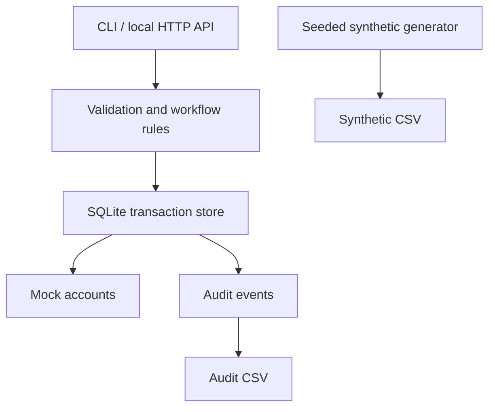

# Access Workflow Automation

[](https://github.com/Tomsakoch0605/access-workflow-automation/actions/workflows/tests.yml)

**A local-only, auditable access request workflow built with Python, SQLite, and the standard library.** It demonstrates approval controls, deterministic synthetic fixtures, state transitions, idempotency, and a mock account service. No production identity platform is integrated.

> **Portfolio Demonstration Notice**
>
> This repository is an independently developed portfolio demonstration inspired by general technical challenges encountered during my professional experience. It uses synthetic data and fictional scenarios, contains no company source code or confidential information, and is not affiliated with or endorsed by my former or current employer.

## Problem and scope

Teams often need to coordinate administrative requests while separating initiation, review, and execution. This project shows the engineering patterns behind such a workflow **without** handling real users, permissions, tokens, or production services. It is a demonstration, **not** a secure production identity management system.

## Features

- Synthetic `DEMO-*` accounts and `REQ-*` request identifiers, with strict validation.
- Actions: `ACTIVATE`, `SUSPEND`, `REACTIVATE` (local SQLite only).
- Request states: `PENDING`, `APPROVED`, `REJECTED`, `FAILED`, `COMPLETED`.
- Separation of duties: requesters cannot approve their own requests.
- Idempotent request creation and completed execution.
- Serialized SQLite writes; transactional account updates and audit entries.
- Bounded retry simulation (up to three attempts); no outbound network calls.
- Local loopback JSON API, CSV fixtures and audit export.
- Pytest tests on Python 3.10 and 3.13 in GitHub Actions.

## Architecture



See [docs/architecture.md](docs/architecture.md) for transition rules and limitations.

## Tech stack

Python 3.10+, SQLite, `http.server` (standard library), Pytest, Ruff and GitHub Actions. There are **no runtime third-party Python dependencies**.

## Install

Requirements: Python 3.10 or newer. From the repository root:

### Windows PowerShell

```powershell
py -m venv .venv
.\.venv\Scripts\python.exe -m pip install -e ".[dev]"
.\.venv\Scripts\python.exe -m access_workflow generate
.\.venv\Scripts\python.exe -m access_workflow demo
.\.venv\Scripts\python.exe -m access_workflow audit
.\.venv\Scripts\python.exe -m pytest -q
```

### macOS / Linux

```bash
python3 -m venv .venv
.venv/bin/python -m pip install -e '.[dev]'
.venv/bin/python -m access_workflow generate
.venv/bin/python -m access_workflow demo
.venv/bin/python -m access_workflow audit
.venv/bin/python -m pytest -q
```

An internet connection is needed only to install the development dependencies. Runtime operations are local.

## Quick start without installation

```bash
PYTHONPATH=src python -m access_workflow generate --output data/synthetic_requests.csv --count 20 --seed 42
PYTHONPATH=src python -m access_workflow demo
PYTHONPATH=src python -m access_workflow audit
```

For PowerShell: `$env:PYTHONPATH = "src"` before invoking Python.

The demo creates a mock account `DEMO-EXAMPLE` and records a successful approval/execution. Its output resembles:

```json
{
  "request_id": "REQ-EXAMPLE",
  "account_id": "DEMO-EXAMPLE",
  "action": "ACTIVATE",
  "requester": "demo-requester",
  "reviewer": "demo-reviewer",
  "status": "COMPLETED",
  "error_code": null,
  "attempts": 1
}
```

The commands create `output/demo.sqlite3` and `output/audit.csv`, both excluded from Git.
Running `demo` again on the same database will not duplicate the completed request or audit event.

## Local REST demonstration

Start the server (listens only on `127.0.0.1`):

```bash
python -m access_workflow serve --port 8765
```

Example calls in another terminal:

```bash
curl http://127.0.0.1:8765/health
curl -X POST http://127.0.0.1:8765/requests -H 'Content-Type: application/json' -d '{"request_id":"REQ-HTTP1","account_id":"DEMO-HTTP1","action":"ACTIVATE","requester":"requester1"}'
curl -X POST http://127.0.0.1:8765/requests/REQ-HTTP1/approve -H 'Content-Type: application/json' -d '{"actor":"reviewer1"}'
curl -X POST http://127.0.0.1:8765/requests/REQ-HTTP1/execute -H 'Content-Type: application/json' -d '{"actor":"worker1"}'
curl http://127.0.0.1:8765/accounts/DEMO-HTTP1
curl http://127.0.0.1:8765/audit
```

On Windows PowerShell, use `curl.exe` rather than the PowerShell `curl` alias. The API is intentionally unauthenticated and must **never** be exposed on a public or shared interface.

## Dataset

`data/synthetic_requests.csv` is generated deterministically with seed `42` and 20 entirely fictional records. Its choices are arbitrary educational fixtures; they are not based on employer data, observed frequencies, operational rules, or internal statistics. Each row represents an independent invented request and is **not** a runnable sequence of real account operations.

Regenerate it:

```bash
python -m access_workflow generate --output data/synthetic_requests.csv --count 20 --seed 42
```

## Testing and verification

```bash
python -m pytest -q
ruff check .
```

Test coverage includes approval/rejection, separation of duties, idempotency, retry limits, state transitions, invalid identifiers, synthetic reproducibility and loopback-only server constraints. A passing test suite does not establish production readiness or absence of security vulnerabilities.

## Technical decisions and trade-offs

- **SQLite instead of a cloud database:** self-contained execution and atomic local writes.
- **Python standard-library HTTP server:** smaller reproducible demo, not hardened for internet exposure.
- **No actual access grants:** the account table represents fictional `enabled` flags only.
- **No role-provider integration or authentication:** caller-supplied actor identifiers demonstrate workflow logic, not verified identity. In production, identity assertions, authorization enforcement, tamper-resistant audit, rate limiting, concurrency controls, and monitoring would be mandatory.
- **Error simulation rather than external failures:** repeatable automated tests without live services.

## Future enhancements

Add authenticated role-based identities, a durable task queue, explicit conflict responses, database migrations, tamper-evident audit storage, and production-grade API framework *only if* adapting this demonstration to a genuinely authorized use case. None is required for the portfolio version.

## Skills demonstrated

Python modular design, SQLite transactions, state machines, synthetic data generation, local API development, defensive validation, idempotency, automated testing, and CI.

## Usage rights

No open-source license is included. The author should confirm their right to apply any future license. The absence of a license does not grant third parties permission to reuse the code.
