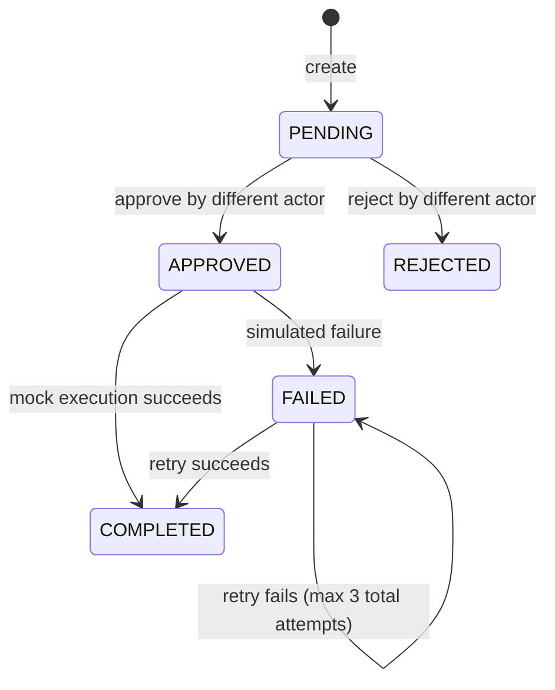

# Architecture and threat boundaries

## Trust model

All actors, requests and accounts are imaginary. The HTTP API runs on loopback and does not authenticate callers. The `requester` and `actor` fields are *assertions in a fictional exercise*, not verified identities. Do not interpret the separation-of-duties check as a security boundary in a production system.

## Workflow

A completed execution is idempotent for the same request ID, and a duplicate create command with conflicting content is rejected. A transaction serializes state and mock account modification with audit insertion. The local audit table is not cryptographically protected; a machine owner can alter it.

## Components

- `core.py`: domain types and validation.
- `store.py`: SQLite database, transitions, mock accounts and audit records.
- `api.py`: loopback-only HTTP interface with bounded JSON request size.
- `synthetic.py`: seeded, synthetic-only CSV generation.
- `cli.py`: user-facing commands and CSV audit export.

## Deliberate exclusions

No browser automation, credential handling, company endpoints, proprietary SQL, third-party identifiers, production account administration, or deployment scripts. Do not forward ports or proxy the local API to a network.

## Known limitations

The server is designed only for controlled local learning. There is no authenticated identity, role registry, rate limit, CSRF protection, or database encryption. This is not an authorization service. It should not run with sensitive data or privileged network access.
